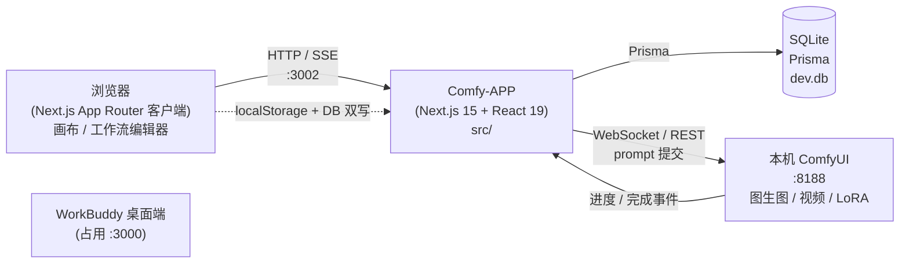
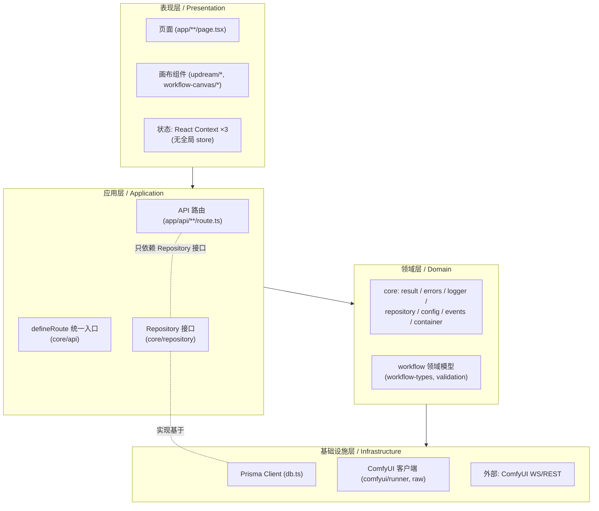
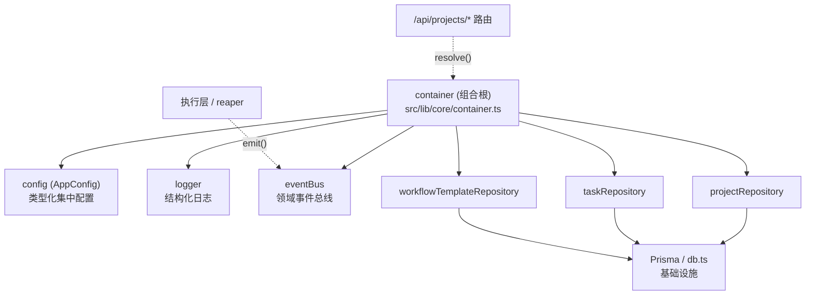

# Comfy-APP 架构文档

> 本文档随架构重构同步生成，描述**目标架构**与当前落地进度。
> 自动 API 文档由 `npm run docs:typedoc`（基于 TSDoc 注释）生成到 `docs/api/`。

## 1. 系统上下文



- 开发服务用 **:3002**（避开被 WorkBuddy 占用的 :3000），见 `dev-3002.bat` / `dev-3002-clean.bat`。
- ComfyUI 为外部依赖，通过 `src/lib/comfyui/*` 适配（kaytool 使用非标准 `execution_success` 信号，见 §5）。

---

## 2. 分层架构（目标）



**关键约束**
- API 路由**只依赖 `Repository` 接口与 `core/*`，不直接 `import { prisma }`**。
- 表现层不直接访问基础设施；所有外部副作用收敛到基础设施层。

---

## 2.5 组合根与依赖注入（DI / Composition Root）

所有核心服务（配置、日志、事件总线、各 Repository）**不再由业务代码各自 `new`
或直接 `import` 单例**，而是在 `src/lib/core/container.ts` 的 `container` 单例里
集中注册（组合根 / Composition Root）。业务与路由代码只通过
`container.resolve("xxxRepository")` 取用，从而获得：

- **依赖倒置（DIP）**：调用方依赖接口，不依赖具体实现；
- **可替换 / 可测试**：`container.register("xxx", mock)` 即可换实现，不改动消费方；
- **依赖关系显式化**：一眼看清「这个路由到底依赖了哪些服务」。



> `defineRoute`（`core/api.ts`）在最新版本已适配 **Next.js 15 异步 `params`**：
> 动态路由的 `params` 改为 `Promise`，在 wrapper 内统一 `await` 后注入 handler，
> 既满足类型校验，也修复了此前动态路由同步读取 `params` 的潜在运行时缺陷。

---

## 3. 统一请求流（API）

消除 30 个路由中重复的 `try/catch` 与手工错误响应。

```mermaid
sequenceDiagram
  participant C as 客户端
  participant R as defineRoute (core/api)
  participant H as 业务 handler
  participant Repo as Repository
  participant DB as Prisma

  C->>R: HTTP 请求
  R begins: getServerUser()
  alt 未认证
    R-->>C: 401 {error:{code:"auth.required"}}
  else 已认证
    R->>H: 注入 {req, user, params}
    H->>Repo: 业务调用 (listByUser / upsertForUser ...)
    Repo->>DB: findMany / upsert ...
    DB-->>Repo: 实体
    Repo-->>H: 实体
    H-->>R: 返回值 (原样)
    R-->>C: 200 + JSON(value)
  end
  Note over R: 任何 throw 的异常<br/>由 normalizeError 归一为 AppError<br/>再序列化为 {error:{code,message}}
```

错误映射表见 `src/lib/core/errors.ts`：
`ValidationError→400 · AuthError→401 · ForbiddenError→403 · NotFoundError→404 · ConflictError→409 · DomainError→422 · IntegrationError→502 · 其余→500`。

---

## 4. 项目画布持久化流（修复「换端口即丢节点」）

```mermaid
flowchart LR
  subgraph Client
    CS["canvas-store.ts\n(原: 仅 localStorage)"]
    Hyd["hydrateFromServer()\n挂载时合并服务端"]
  end
  subgraph Server
    API["/api/projects\ndefineRoute + ProjectRepository"]
    DB2[("Project 表\nnodes/edges JSON")]
  end

  CS -- "upsertProject 写本地" --> LS[("localStorage\ncomfyapp.canvas.projects.v1")]
  CS -- "异步 write-through" --> API
  API --> DB2
  Hyd -- "GET 列表 + 合并" --> API
  API --> Hyd
  Hyd --> LS
  Note right of Hyd: 服务端较新则胜出<br/>本地孤立项目反向推回服务端(迁移)
```

- `Project` 表主键直接复用客户端 `proj_*` id（与 `Task.projectId` 零迁移对接）。
- 详见 `src/lib/core/repository.ts` (`ProjectRepository`) 与 `src/components/updream/canvas/canvas-store.ts`。

---

## 5. 任务执行与 Reaper 管道（ComfyUI 异步）

```mermaid
flowchart TD
  Q["/api/generate\nbuildCustomWorkflow"] --> E["enqueue → processQueue → postPrompt"]
  E --> WS["ComfyUI WebSocket\nexecuting / progress"]
  WS --> KS["kaytool 非标准\nexecution_success 信号"]
  KS --> SSE["SSE /api/tasks/[id]/stream\n{state|progress|log|done|error}"]
  SSE --> UI["前端 GlobalStepLogPanel"]

  subgraph Reaper["孤儿任务回收 (runner.ts 单例)"]
    RQ["reapStaleQueuedTasks\nQUEUED 超 30s 且无 promptId → FAILED"]
    RR["reapStaleRunningTasks\nRUNNING 孤儿: 双查 /history + /queue → FAILED"]
  end
  E -. "冷启模块副作用启动" .-> Reaper
  Reaper --> DB3[("Task 表\nstatus / logs")]

  Note over KS: 需重入保护<br/>(execution_success 可能被多次投递)
```

---

## 6. 架构重构路线图（分阶段，低风险渐进）

| 阶段 | 目标 | 关键动作 | 涉及热点 |
|------|------|----------|----------|
| **P0 基座** ✅ | 建立模式骨架 + 落地 | `src/lib/core`：result/errors/logger/repository/api + **config/events/container** | projects 路由示范（已接入 DI）|
| **P1 数据访问** ⚡ | 去裸 Prisma（分批落地） | `Model`/`WorkflowModelTag` Repository + DI；`defineRoute` 增强 `legacyError`/`successStatus`/`NextResponse` 逃生舱；已迁 `workflow-models`+`models` + `film/[id]`(及 cancel/start/compose) + `train/[id]`(及 cancel)/`train` 共 9 路由到 `defineRoute`+`legacyError`（错误体逐字节兼容旧前端）；剩余 god-route（workflows、generate、film/route、skills、models/config、subgraph）与公共/流式/formData 路由待逐路由设计 | modelRepository / workflowModelTagRepository、workflow-models、models、film/*、train/* 路由 |
| **P2 客户端状态** | 引入轻量 store | 用 Zustand 替代 3 个 Context + prop-drill；画布状态收敛 | ProjectCanvas / CanvasNode / wf-editor-inner |
| **P3 执行层解耦** | Strategy/Adapter | `runner.ts`(1971 行) 拆为 enqueue / executor / reaper；ComfyUI 协议适配为 Adapter | runner.ts、raw.ts |
| **P4 巨型组件拆分** | 单一职责 | `wf-editor-inner`(2638) / `WorkflowLibrary`(2315) / `DynamicWorkflowForm`(1835) 按关注点拆分 | 对应组件 |
| **P5 性能** | 渲染/查询优化 | React.memo/虚拟化、`useMemo` 收敛、查询加索引、消除 N+1 | 画布、列表、API |
| **P6 测试与文档** | 质量护栏 | 引入 Vitest 单测核心层；Typedoc 全量生成；持续补全 mermaid | 全仓 |

> **原则**：每个阶段均可独立上线、不破坏 :3002 运行服务；先横向铺「基座+Repository」，再纵向切「巨型组件」。

---

## 7. 设计模式应用索引

| 模式 | 落地点 | 解决的问题 |
|------|--------|------------|
| **Repository** | `core/repository.ts` | 去裸 Prisma、按用户隔离、可单测 |
| **Result (函数式)** | `core/result.ts` | 显式失败、消除吞异常 |
| **统一错误契约** | `core/errors.ts` + `core/api.ts` | 稳定错误码、安全信封 |
| **模板方法/高阶函数** | `defineRoute` | 收敛 30 路由的认证+错误处理样板 |
| **结构化日志** | `core/logger.ts` | 统一级别/上下文，可替换后端 |
| **Config 模式** ✅ | `core/config.ts` | 类型化集中配置 + zod fail-fast 校验，消灭散落 `process.env` |
| **Observer/Pub-Sub** ✅ | `core/events.ts` | 领域事件总线，任务状态多消费者解耦（故障隔离） |
| **DI / Composition Root** ✅ | `core/container.ts` | 组合根集中注册服务，DIP、可替换、可测试 |
| **Adapter (规划)** | `comfyui/*` | 隔离 kaytool 非标准信号差异 |
| **Strategy (规划)** | workflow modes | 多工作流类型行为可插拔 |
