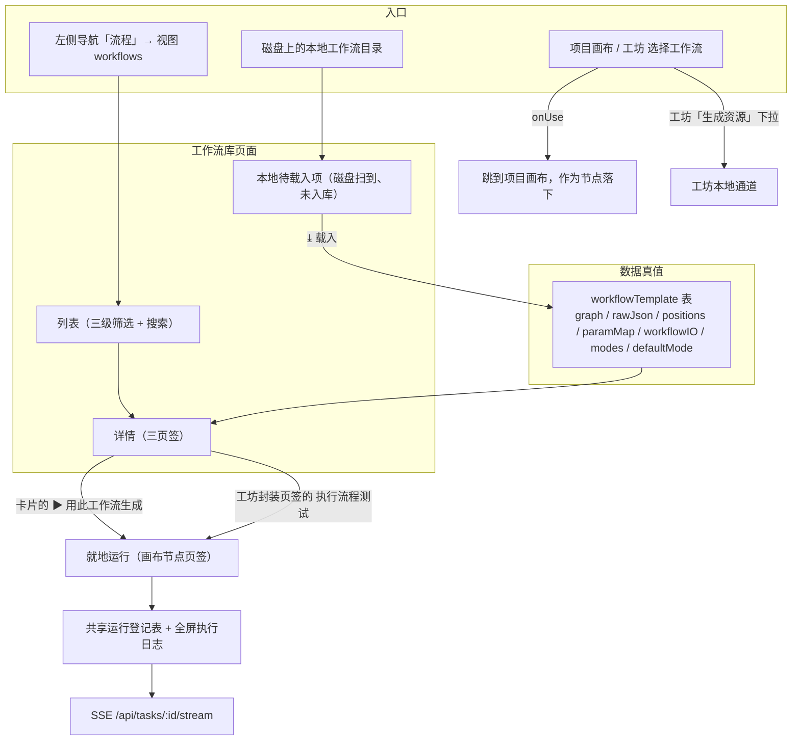
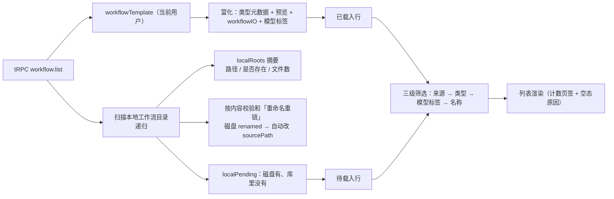
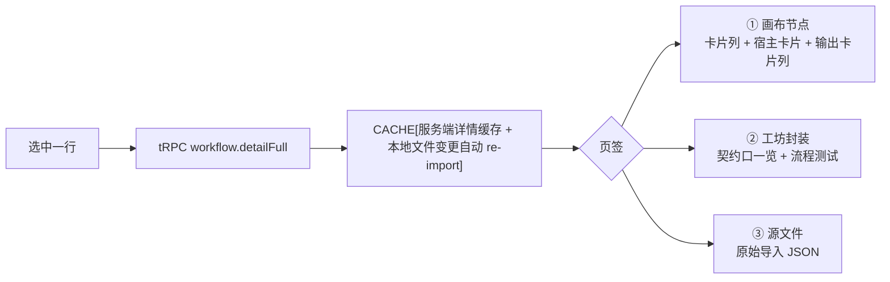
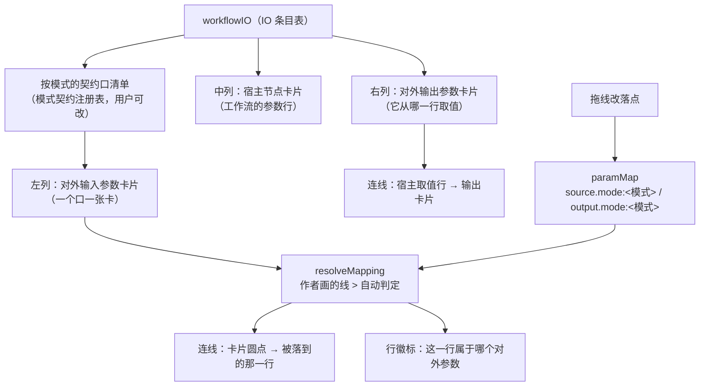
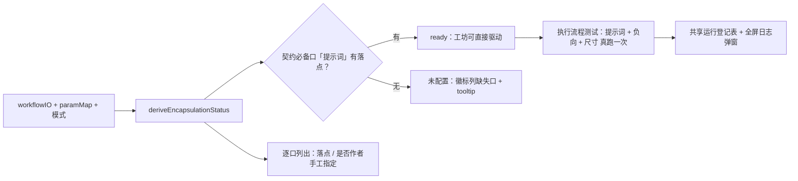
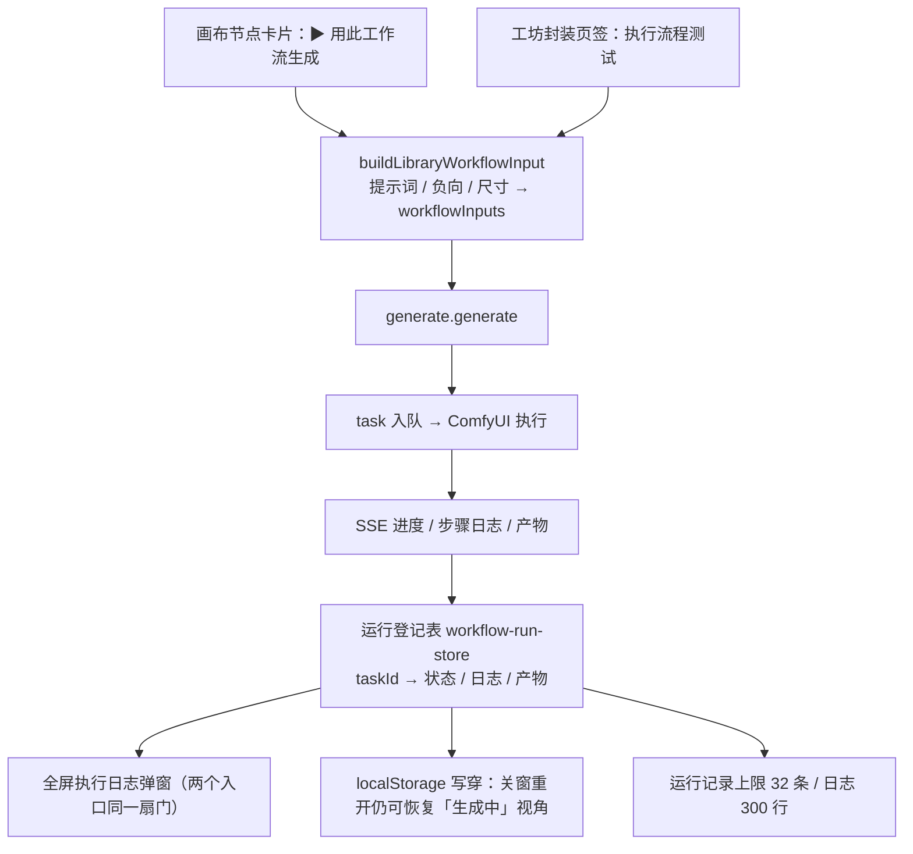
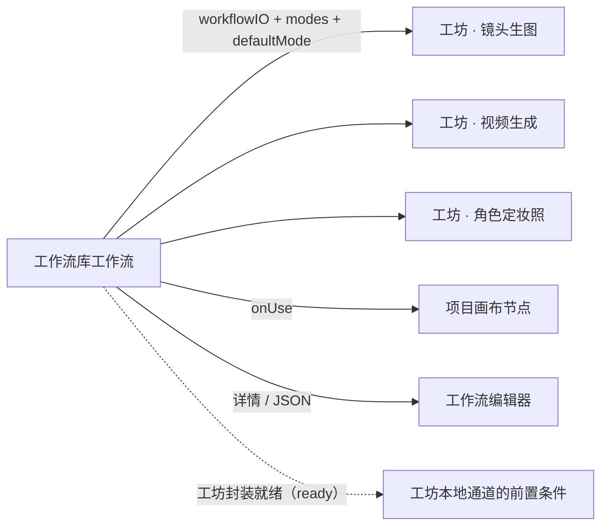

# 功能流程 · 工作流库（Workflow Library）

> 面向「把控方向是否正确」的流程图文档：**先看流程图确认流向，再看判据表核对实现**。
> 工作流库 = 浏览 / 导入 / 编辑 / 就地运行**一份 ComfyUI 工作流**的页面，
> 同时是**工坊的生成能力来源**（工坊本地通道只跑这里配好的工作流）。
> 代码落点见 [术语表 §4](../glossary.md)。
>
> **术语口径**：本文按 [术语表](../glossary.md) 用正式名 —— 「工作流库」（导航叫「流程」，
> id `workflows`）、「工作流编辑器」（全屏图编辑器）、「工作流编辑器画布」（编辑器里的图区）。
> 不写「流程库」「workflow 页面」。
>
> **占位符约定**：本文中 `{{...}}` 形式的占位符代表文档引用的真实值，由
> `pnpm doc:check` 运行时从源码/配置动态提取核对；语义见
> [`docs/reference-facts.md`](../reference-facts.md)。改动上游源码后运行
> `pnpm doc:gen` 同步 `docs/generated/`。

---

## 1. 一句话定位与边界

| 问题 | 答案 |
|---|---|
| 它是什么 | 一份 ComfyUI 工作流的**全生命周期管理页**：导入 → 入库 → 看结构 → 配对外参数 → 就地运行 |
| 它不是什么 | 不是项目画布（那是创作流程编排）；不是工坊（那是 LLM 创作管线） |
| 页面结构 | 左列表 + 右详情；详情三个页签：**画布节点** / **工坊封装** / **源文件** |
| 业务逻辑 | 控制器 `useWorkflowLibrary()`（列表 / 筛选 / 选择 / 动作编排），视图只消费 controller |
| 为什么它是工坊的依赖 | 工坊本地通道**没有内置模板**，必须先在这里把对外参数配好，工坊才驱动得起来 |

---

## 2. 总览流程（三条主干）



**流向要点（方向是否正确就看这四条）**：

1. **一份工作流只有一种格式**：入库时统一落成可执行的 API 图（`graph`），
   `rawJson` 只是原始导入件（用于源文件页签、定位与下载）。
2. **磁盘 ↔ 库是「跟踪」关系而非拷贝**：来自本地文件的工作流记住 `sourcePath`，
   文件变了可同步回来；库删了不动磁盘文件。
3. **「对外参数」是契约，不是工作流的能力**：契约口一律常驻（提示词 / 负向提示词 /
   尺寸 / 首帧 / 尾帧 / 参考图 / 时长），显示与否只由**模式**决定；工作流只决定
   「每个口落到哪一行端口」，落不到就如实显示「未配置」。
4. **两个运行入口共用一个动作**：画布节点卡片与工坊封装页签是同一份封装口径下的
   两次运行，登记进**同一张运行登记表**、共用**同一扇日志弹窗**。

---

## 3. 列表：数据从哪来



| 判据 | 实现 |
|---|---|
| 列表为空的**原因**怎么告诉用户 | 服务端回 `localRoots` 摘要，前端派生「一个都没解析到 / 全不可访问 / 目录里没有文件」三类文案（`deriveLocalRootsHint`） |
| 磁盘文件被重命名了怎么办 | 服务端按内容校验和找到新路径并自动重链，前端一次 toast 提示 |
| 「文件变了」怎么表达 | `diskDirty`（磁盘 mtime > 入库记录）→ 卡片出现「↻ 同步」；`diskMissing` → 标「文件已不存在」 |
| 首次拉取卡住怎么表现 | 8s 未拿到数据 → 可重试的「加载较久」出口，而不是伪装成「没有工作流」 |
| 计数的口径 | 来源页签把待载入项计入 `local`；类型页签待载入项只计入 `all`（它们没有 taskType） |

**红线**：**空列表不许笼统说「还没有工作流」**。三份不同原因（没配目录 / 目录不可访问 /
目录里没文件）必须各自可归因 —— 否则用户看到的是「工作流全没了」。

---

## 4. 入库：三条导入路径

```mermaid
flowchart TD
  START["导入"] --> PATH{"来源"}
  PATH -->|粘贴 / 拖入 JSON| DETECT{"格式识别"}
  PATH -->|本地待载入项 ⤓| LOCAL["单文件导入（记住 sourcePath）"]
  PATH -->|模型标签 / 类型编辑| PATCH["PATCH 更新已有行"]

  DETECT -->|API 格式| API["直接用 graph"]
  DETECT -->|工作流(RAW)格式| RAW["convertRawToApi<br/>失败回落 fallbackRawToApi + warnings"]
  API --> PERSIST["入库"]
  RAW --> PERSIST
  LOCAL --> PERSIST
  PERSIST --> DB["workflowTemplate"]
  PERSIST --> PM["detectParamMap：初判落点"]
  PERSIST --> IO["workflowIO：对外 IO 条目"]
```

| 判据 | 实现 |
|---|---|
| 支持哪些格式 | ComfyUI「导出(API格式)」与「导出(工作流格式)」（RAW 会转成 API 图） |
| 只有 RAW 的导入能不能跑 | `hasApi` 判定可执行性；只有 RAW（graph 为空）时 `usable = false`，卡片如实标注来源 |
| 三种标记的含义 | `hasApi`（可执行）/ `hasRaw`（有原始件）/ `apiOrigin`（图来自用户导出还是转换派生） |
| 「本地」还是「在线」 | 有 `sourcePath` = local（跟踪磁盘文件）；否则 online（粘贴 / 纯 API） |
| 转换告警去哪了 | 导入响应里的 `warnings` → 导入面板提示，不静默丢弃 |

**红线**：识别不出格式（既无 `class_type` 也无 raw 的 `type + pos`）时**必须报错**，
不许落一条空图 —— 空图会在生成时变成一个空提示词任务，用户侧完全无提示。

---

## 5. 详情三个页签



### 5.1 画布节点（对外参数 ↔ 端口落点）



| 判据 | 实现 |
|---|---|
| 卡片列显示哪些口 | **只由模式契约决定**（`exposedParamsForMode` / 模式契约注册表），契约口一律常驻 |
| 落点怎么定 | 作者画过的线优先（`manualByMode`），否则自动判定（`autoMapEntries`）；判不出来就是**未配置** |
| 为什么一个口能连多条线 | 「尺寸」这类口一对多（宽高比 + 百万像素 + 倍数由同一块控件录入），每个候选端口各一条线 |
| 断开怎么表达 | 画不出线（悬空即「没接」），而不是画到别处 |
| 改完为什么立即生效 | PATCH 返回前**主动失效服务端详情缓存**（否则 30s 内重拉拿回旧值） |

### 5.2 工坊封装（工坊视角的可用性）



| 判据 | 实现 |
|---|---|
| 「能不能用」只认什么 | 契约必备口**提示词**是否已有落点（与实际生成链路同一套判定） |
| 为什么未配置必须显式可见 | 用户要知道「为什么工坊驱动不了」，而不是看到一个空表单 |
| 两个页签的口径是否一致 | 是：封装视图与画布节点卡片列读**同一份**模式契约（`modeContractEntries`） |

### 5.3 源文件

| 判据 | 实现 |
|---|---|
| 展示哪个 JSON | 优先磁盘原始导入件（`rawJson`）；纯 API 导入没有原始件时回退到可执行图，并**如实标注**是回退 |
| 详情加载态的判据 | 「当前选中行的详情还没到过」，而不是 `isLoading`（避免换行时闪一屏占位） |

---

## 6. 就地运行（两个入口，同一份运行态）



| 判据 | 实现 |
|---|---|
| 两个入口为什么共用一个运行态 | 它们本来就是同一个动作的两种触发方式；各写各的会变成「一边在跑，另一边像是执行不了」 |
| 重开窗口后还能看到刚才的运行吗 | 能：模块级 Map + localStorage 写穿，历史日志由 SSE 回放按 `(t, msg)` 去重补齐 |
| 服务端真值以谁为准 | `task` 表（状态 / 进度 / 日志 / 产物）；客户端只是观察态 |
| 终态记在哪 | 运行登记表按 `taskId` 记 `done` / `failed`，并保留产物地址与错误信息 |

---

## 7. 对外交付给谁（消费方）



| 消费者 | 取什么 | 判据 |
|---|---|---|
| 工坊（生图 / 视频 / 定妆照） | `workflowIO` + 模式码 + 封装就绪 | 内容类别页签按 image / video 分栏；素材按 `typeCategory` 富化 |
| 项目画布 | 完整 API 图 + `paramMap` | 「使用」动作把待落下节点的 id 交给画布 |
| 工作流编辑器 | 图 + 位置 + 原始件 | 编辑器是**整个界面**，图区是「工作流编辑器画布」 |

**红线**：模式码（`taskType` / `modes` / `defaultMode`）是工坊与库之间**唯一的生成模式判据**，
不许从内容类别（image / video）反推。

---

## 8. 删 / 改 / 同步的边界

| 动作 | 会动什么 | 不会动什么 |
|---|---|---|
| 删除工作流 | 删库里的行 | **不动磁盘文件** |
| 「↻ 同步」 | 用磁盘最新内容重导入（图 / 原始件 / 位置 / 落点），刷新 mtime 与校验和 | 不动用户在库里配的模式与标签（尽量保留） |
| 「载入」（待载入项） | 建一行并记住 `sourcePath`，此后跟踪文件变化 | 不拷文件 |
| 编辑模式 / 模型标签 | 乐观更新 + 失败回滚重拉 | 不动图 |
| 拖线改落点 | 写 `paramMap` 对应模式命名空间 | 不改 `workflowIO` 本身 |

---

## 9. 失败路径与出口

| 失败点 | 用户看到什么 | 落点 |
|---|---|---|
| 列表拉取失败 | 列表错误条（重新拉取成功即消失） | `loadError` 通道 |
| 首次拉取超时 | 「加载较久」+ 重试 / 打开日志面板 | `loadStalled` |
| 动作失败（删除 / 同步 / 下载） | 动作错误条（**不自动消失**，只有用户重试才清） | `actionError` 通道 |
| 空列表 | 三类可归因文案（见 §3） | `localRootsHint` |
| 磁盘文件已不存在 | 「文件已不存在」标记（不给同步按钮） | `diskMissing` |
| 导入格式无法识别 | 导入面板报错，不入库 | `create` 的 BAD_REQUEST |
| 详情缓存过期 | —（PATCH 主动失效缓存，不靠等 TTL） | `invalidateWorkflowDetailCache` |

---

## 10. 改动本流程时的自查

- [ ] 改对外参数契约 → 同步 [工坊流程 §6/§7](feature-workshop-flow.md)（同一份契约的两端）
- [ ] 新增页签 / 卡片列 → 更新 `DETAIL_TABS` 与本文 §5 流程图
- [ ] 改列表字段 / 磁盘跟踪判据 → 同步 `WorkflowRow` 与本文 §3
- [ ] 新增运行入口 → 必须登记进**同一份**运行登记表（否则又会出现「两个执行视角」）
- [ ] 改动任何 `src/lib/**` → 先读 [规范 18](../standards/18-lib层规范.md)
- [ ] 文档改动后跑 `pnpm doc:gen`（先 `doc:check` 后 `doc:render`）

---

## 11. 关联文档

- [工坊 · 功能流程](feature-workshop-flow.md)（消费方）
- [术语表 §4](../glossary.md)（工作流 / 工作流库 / 工作流编辑器 / 对外参数 / 就地运行）
- [文档中心索引](../README.md)
