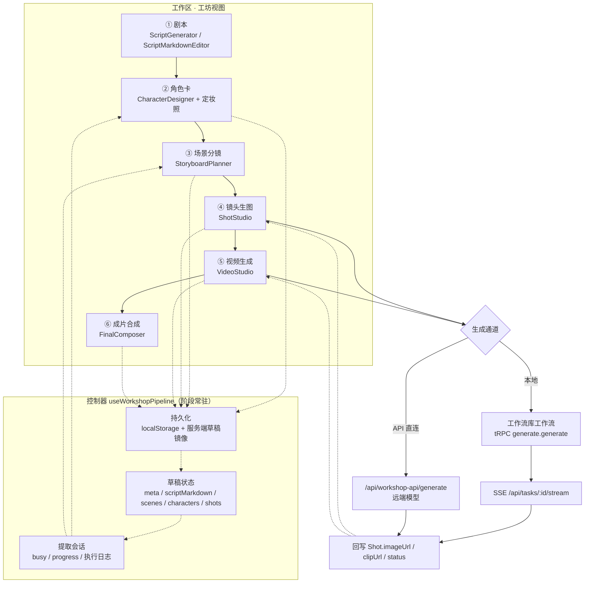
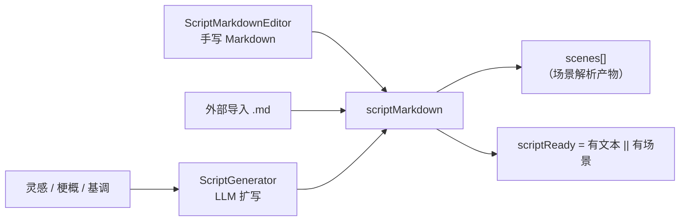
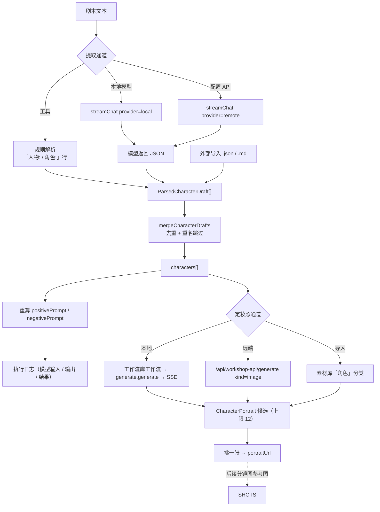
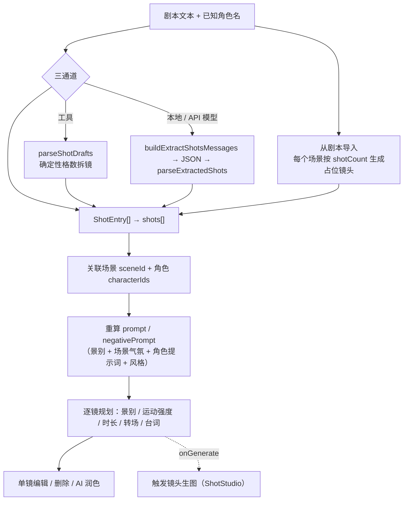
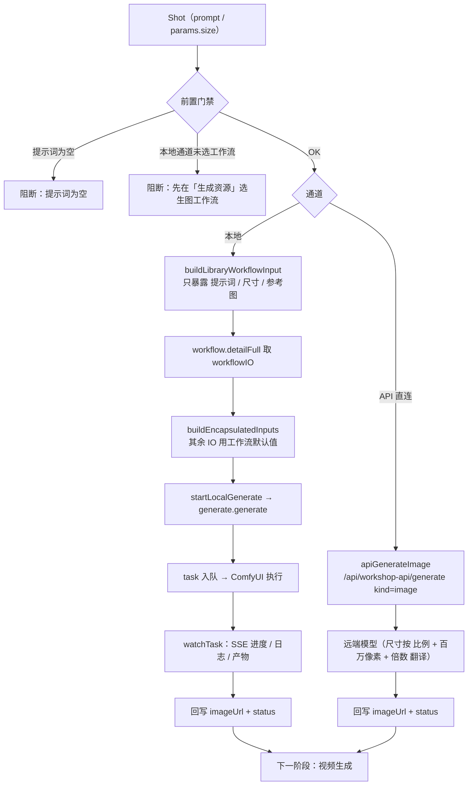
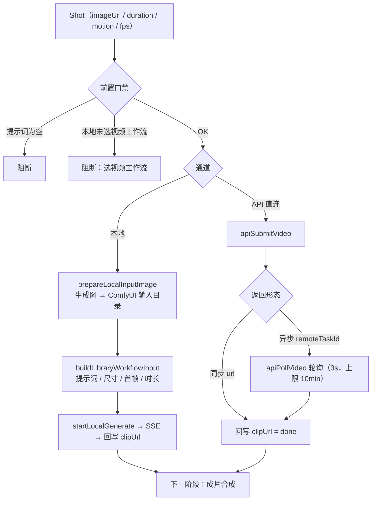
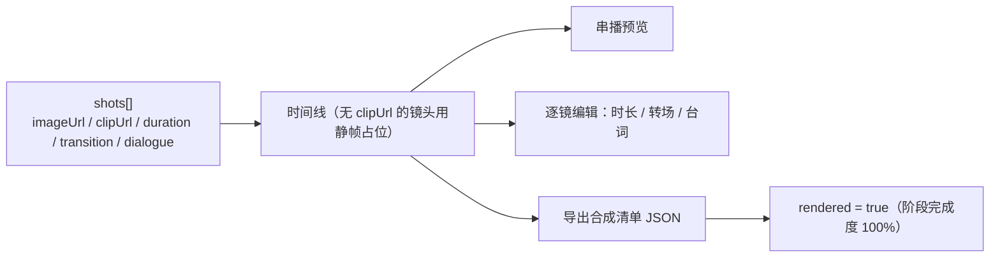
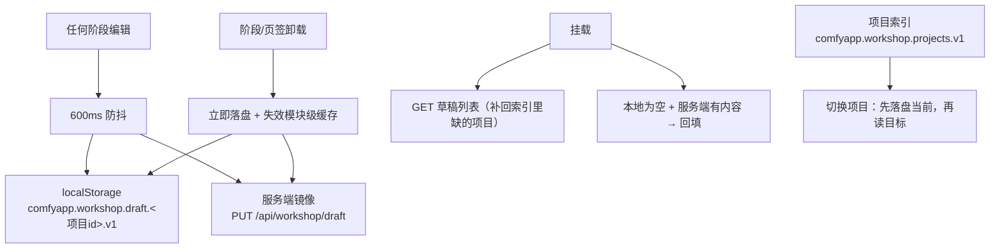
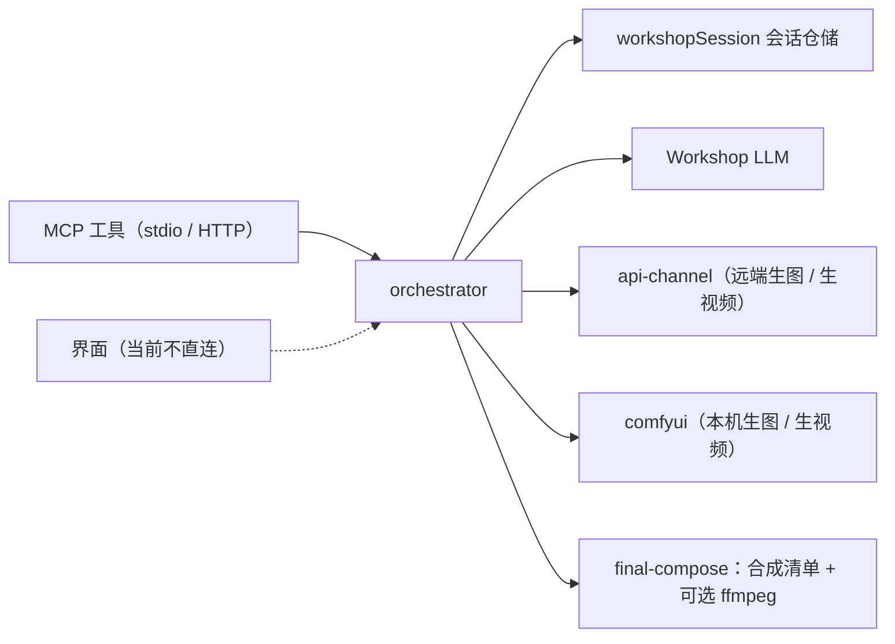

# 功能流程 · 工坊（Workshop）

> 面向「把控方向是否正确」的流程图文档：**先看流程图确认流向，再看判据表核对实现**。
> 工坊 = 剧本 → 角色卡 → 场景分镜 → 镜头生图 → 视频生成 → 成片合成 的创作流水线，
> 代码落点见 [术语表 §6](../glossary.md)（「工坊」一行）。
>
> **术语口径**：本文一律按 [术语表](../glossary.md) 用正式名 —— 说「运行」时补名词
> （服务端叫**任务**、前端叫**运行记录**、ComfyUI 内部叫**执行**）；说「画布」时补限定词
> （工坊不画图，用**项目画布** / **工作流编辑器画布**）。
>
> **占位符约定**：本文中 `{{...}}` 形式的占位符代表文档引用的真实值，由
> `pnpm doc:check` 运行时从源码/配置动态提取核对；语义见
> [`docs/reference-facts.md`](../reference-facts.md)。改动上游源码后运行
> `pnpm doc:gen` 同步 `docs/generated/`。

---

## 1. 一句话定位与边界

| 问题 | 答案 |
|---|---|
| 它是什么 | 面向「编剧型用户」的**全链路创作管线**：从一句灵感走到成片清单 |
| 它不是什么 | 不是 ComfyUI 图编辑器（那是**工作流编辑器**，见 [工作流库流程](feature-workflow-library-flow.md)）；不是素材相册（那是「项目」视图 `works`） |
| 用户界面 | 工作区 → 视图「工坊」；阶段导航在左侧（`WorkshopStageNav`），内容区一次只渲染一个阶段 |
| 业务逻辑 | 控制器 `useWorkshopPipeline()` 一处收口（阶段状态 / 草稿持久化 / 生成编排 / 派生进度），视图只消费 controller |
| 生成能力从哪来 | **没有内置模板**。本地通道一律使用**工作流库**里已配好对外参数的工作流；另一条通道是**API 直连**（远端模型） |
| 与 ComfyUI 的关系 | 本地通道最终落到 `task` 表 + ComfyUI 执行，与项目画布**同一条**链路（`generate.generate` → SSE） |

---

## 2. 总览流程（阶段主干）

**流向要点（方向是否正确就看这四条）**：

1. **顺序是推荐流，不是闸门**：六个阶段**始终可进入**，前置未满足只给「温和提示 + 一键跳回」
   （`stagePrereq`），不阻断 —— 用户可以自由跳阶段补内容。
2. **数据只沿一个方向流**：上游产出 → 下游消费，下游**不反向改写**上游字段。
   剧本 → 场景；场景 + 角色 → 分镜提示词；分镜 → 镜头图；镜头图 → 视频首帧；镜头数据 → 成片时间线。
3. **两条生成通道在「镜头生图 / 视频生成」才分叉**，且**同阶段内可切换**，互不影响上游数据。
4. **成片合成是纯客户端**：时间线预览 + 时长/转场编辑 + 合成清单导出，不再触发生成。

---

## 3. 阶段 ① 剧本

| 判据 | 实现 | 落点 |
|---|---|---|
| 「剧本就绪」如何判定 | `!!scriptMarkdown.trim() \|\| scenes.length > 0` | `use-workshop-pipeline.ts` 的 `scriptReady` |
| 场景从哪来 | 剧本 Markdown 按「场景标题 / Δ动作 / Vx 台词」结构解析 | `src/lib/workshop/script-parser.ts`、`script-parse.ts` |
| 剧本编辑器保存了什么 | `meta.scriptMarkdown`（Markdown 原文） | `saveScriptEditor()` |

**红线**：剧本阶段是**唯一**能生产 `scenes[]` 的阶段；角色卡 / 分镜阶段只读剧本文本，
不反写剧本内容（改剧本后靠重新提取刷新下游，而不是就地改下游对象）。

---

## 4. 阶段 ② 角色卡（含定妆照）

| 判据 | 实现 |
|---|---|
| 提取会话跨阶段不丢 | `ExtractSession` 收在控制器（`useExtractSession`），阶段组件卸载不影响后台 async |
| 执行日志为什么留得住 | 控制器常驻保存最近一次日志 + 异步落盘 `log/workshop/`（按环节 `character` / `storyboard`） |
| 候选上限 | 单角色 12 张（超出丢最旧），日志 200 条 | 
| 第一张候选是否自动成为定妆照 | 是（`withPortraitCandidate` 在 `portraitUrl` 为空时顶上） |
| 定妆照的用途 | 作为后续分镜图的参考图基准（下游消费，角色阶段不消费下游任何东西）——镜头生图本地通道经 `preparePortraitReferences` 把它上传进 ComfyUI 输入目录后随 `referenceImages` 下发，落点仍是作者连的参考图口 |

**红线**：候选与定妆照**写在角色对象上**（随草稿一起持久化），不另建表 —— 新增字段无需迁移。
其余进程态（busy / 进度 / 日志）**不进草稿**，只留会话与 `log/workshop/`。

---

## 5. 阶段 ③ 场景分镜

| 判据 | 实现 |
|---|---|
| 分镜提示词何时算出来 | 分镜阶段首次生成；镜头生图阶段对**空提示词**做一次补偿填充 |
| 用户手改过的提示词会不会被覆盖 | 不会：`editedRef` 记录手改过的镜头，自动填充跳过它们 |
| 「场景 → 镜头」的基准数量 | `scene.shotCount`（导入时按它铺占位镜头） |
| 分镜产出被谁消费 | 镜头生图（`prompt` / `params.size`）、视频生成（`duration` / `motion`）、成片（`transition` / `dialogue`） |

**红线**：分镜阶段只写 `shots[]`；提示词重算走纯函数 `buildShotPrompt` / `buildShotNegative`
（`src/lib/workshop/prompt-builder.ts`），不得在视图里就地拼串。

---

## 6. 阶段 ④ 镜头生图（第一次分叉）

| 判据 | 实现 |
|---|---|
| 本地通道的**唯一**可执行来源 | 工作流库里的工作流（按内容类别 `image` 过滤后供选择） |
| 工坊对外暴露哪些参数 | 提示词 / 负向提示词 / 尺寸 / 参考图 —— 其余全部用工作流默认值 |
| 尺寸怎么表达 | 只有两种：比例 + 分辨率，或比例 + 百万像素 + 倍数（宽高由尺寸表按场景现算） |
| 批量生成的循环会不会被卡死 | 单镜有 30 分钟无响应超时保险，超时按失败收尾并继续下一镜 |
| 未落到端口的输入会不会静默丢 | 不会：发起前提示条列出「本次未生效」的口（`describeUnmatchedInputs`），引导去工作流库连线 |
| 刷新后进行中的任务怎么回来 | 重挂载先查 task 真值（`fetchTaskSnapshot`）：已成功直接回写产物，仍在跑才重订阅 SSE，查无真值按失败收尾 |
| 运行态放哪 | 阶段内用 `watchTask` 直连；工作流库内的就地运行另有一套跨窗口运行登记表 |

**红线**：`workflowId` 为空时**必须阻断**并在界面给出可行动提示 —— 没有内置模板可回落，
带着空 id 去拉详情只会得到一条无落点的请求（表现为「点了没反应」）。

---

## 7. 阶段 ⑤ 视频生成

| 判据 | 实现 |
|---|---|
| 图生视频的首帧从哪来 | 上游镜头图；本地通道需先上传到 ComfyUI 输入目录换文件名 |
| 视频任务刷新后怎么恢复 | `clipTaskId` 随草稿持久化，重挂载按 task 真值恢复（与生图的 `taskId` 同一机制：已成功回写产物、在跑才重订阅） |
| 「时长」怎么落下去 | 同一个口两种单位：按帧的端口吃 `frames`、按秒的吃 `duration`（由界面按 fps 折算） |
| 首帧 / 尾帧怎么区分 | 按产出节点类名（`LoadImageFirstFrame` / `LoadImageLastFrame` / `LoadImage`）判角色，再按端口名兜底 |
| 视频工作流与生图工作流为什么分开选 | 对外参数口径不同（生图无首帧、视频有），共用一个 id 会互相串味 |
| 远端异步任务的进度 | 服务端真值是 `task` 表；客户端轮询只在远端 API 通道使用 |

**红线**：视频阶段不得改写 `imageUrl`（那是上游产物），只写 `clipUrl` / `clipStatus`。

---

## 8. 阶段 ⑥ 成片合成

| 判据 | 实现 |
|---|---|
| 成片路径有几条 | 界面侧：纯客户端时间线 + 合成清单导出（`FinalComposer`）；服务端侧另有 `composeFinal`（合成清单落盘 + 可选 ffmpeg 渲染），当前由 MCP 工具调用 |
| 「阶段完成」怎么记账 | `markRendered()` 置 `rendered`，`computeStageRatios` 据此把 render 记 1 |

**红线**：界面成片**不再触发生成**；服务端 ffmpeg 渲染是可选项，缺 ffmpeg 时如实提示
「本次仅产出合成清单」，不静默降级。

---

## 9. 草稿持久化（多项目）

| 判据 | 实现 |
|---|---|
| 为什么同时写 localStorage 与服务端 | 清缓存 / 隐私模式 / webview 存储重置都不该丢内容；**服务端真值优先**，但只覆盖「本地为空」的项目 |
| 切页签后内容为什么还在 | 卸载兜底保存 + 模块级缓存失效（否则重挂载会读回首挂载那份旧缓存） |
| 项目上限 | 最少保留 1 个（`deleteProject` 在只剩一个时为空操作） |
| 服务端镜像**不含**什么 | 工坊选定的工作流 id（`workflowId` / `videoWorkflowId`）只落本地 —— 它们是本机设备的选择 |

---

## 10. 两条生成通道对照

| 维度 | 本地 · ComfyUI 工作流 | API 直连（远端模型） |
|---|---|---|
| 可执行来源 | 工作流库工作流（必须已配好对外参数） | 设置页「远端模型」或工坊 API 通道设置 |
| 请求入口 | `generate.generate`（tRPC） | `/api/workshop-api/generate`（relay） |
| 进度 / 日志 | SSE `/api/tasks/:id/stream`（含节点级进度与执行日志） | 一次性响应；异步任务的进度靠轮询 |
| 参数翻译 | `buildEncapsulatedInputs`（统一输入 → 端口） | 远端模式适配器（统一输入 → 接口字段名） |
| 密钥位置 | 无（本机） | 只在服务端（浏览器只见脱敏视图） |
| 失败出口 | 阶段内错误条 + 执行日志 | 阶段内错误条（relay 错误信息归一） |

---

## 11. 服务端编排（MCP / 未来的服务端调用）

| 判据 | 实现 |
|---|---|
| 阶段划分 | 服务端 5 阶段（脚本 / 角色 / 分镜 / 生图 / 生视频）+ 成片合成；界面 6 阶段（成片合成是纯客户端） |
| 会话存哪 | `workshopSession` 表（`workshopSession` 状态为一个 JSON 列） |
| 为什么服务端不复用界面状态 | 服务端只存**创作结果**；界面的多项目草稿是另一套（前端设备态 + 服务端镜像），两者不互相写入 |
| 工具入口 | `pnpm mcp:stdio` / `pnpm mcp:http`，工具清单见 [工坊 MCP](../workshop-mcp.md) |

---

## 12. 失败路径与出口（必须有日志 + 用户可见出口）

| 失败点 | 用户看到什么 | 日志落点 |
|---|---|---|
| 剧本为空就提取角色 / 分镜 | 提取按钮禁用 + 原因文案（「先在剧本阶段编写」） | — |
| 模型返回不是合法 JSON | 错误条 + 可重试提示，建议改「工具」通道 | 执行日志面板 + `log/workshop/<环节>` |
| 本地通道没选工作流 | 阻断文案「先在右侧生成资源选择工作流」 | — |
| 任务失败 / 中断 | 镜头状态置 `failed` + 错误条 | task 日志（SSE `log` 帧）+ 执行日志 |
| 用户主动取消（本机任务） | 镜头行「取消」按钮 → task.cancel → CANCELLED 终态，状态回 `failed` + 提示「已取消，可重新生成」 | — |
| 输入未落到工作流端口（unmatched） | 发起前提示条：哪些设置本次未生效 + 引导去工作流库连线 | — |
| 任务 30 分钟无响应 | 超时按失败收尾，批量循环继续 | 阶段内错误条 |
| 服务端草稿不可用 | 静默降级为纯本地 | — |
| 远端 API 未配置 | 通道按钮标注「未配置」+ 引导打开通道设置 | — |

---

## 13. 改动本流程时的自查

- [ ] 改阶段划分 / 顺序 → 同步 `STAGE_DEFS`、`STAGE_TITLES`、本文第 2 节流程图
- [ ] 改对外参数口径 → `src/lib/workshop/workflow-encapsulation.ts` +
      [工作流库流程 §5](feature-workflow-library-flow.md)（两处是同一份契约的两端）
- [ ] 新增生成通道 → 本文第 10 节表格 + 第 6/7 节的门禁分支
- [ ] 改草稿结构 → 服务端 DTO（`draft-sync-shared.ts`）与本文第 9 节同步
- [ ] 改动任何 `src/lib/**` → 先读 [规范 18](../standards/18-lib层规范.md)（Node-only 三选一、
      分层 element、文件/函数长度棘轮）
- [ ] 文档改动后跑 `pnpm doc:gen`（先 `doc:check` 后 `doc:render`）

---

## 14. 关联文档

- [工作流库 · 功能流程](feature-workflow-library-flow.md)（工坊的生成能力来源）
- [工坊 MCP](../workshop-mcp.md)（服务端编排与工具清单）
- [术语表](../glossary.md)（工坊 / 工作室 / 工作流库 / 运行三义）
- [文档中心索引](../README.md)
